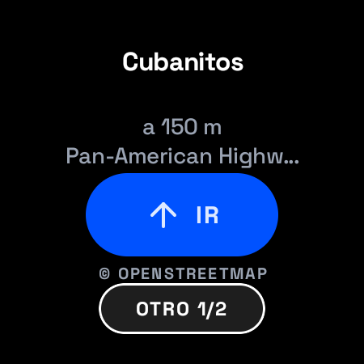
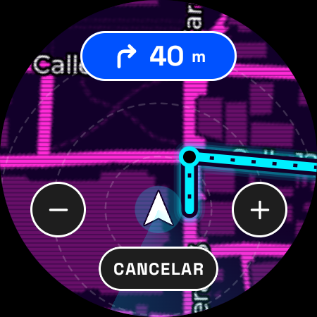
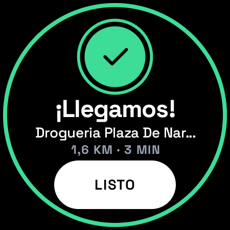
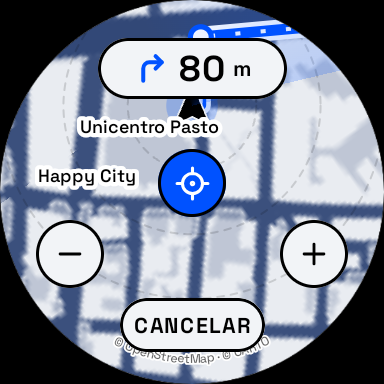
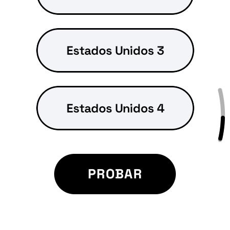
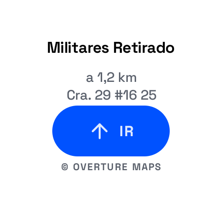

# WGO (Where We Go)

A 100% native **Wear OS** navigator for drivers and pedestrians in Pasto, Colombia: say where you want to go, confirm
with one tap, and follow a north-up (or heading-up) radar map with haptic (and optional spoken) turn cues, screen on
or off.
Kotlin + Jetpack Compose for Wear OS; built and tested on a Samsung Galaxy Watch5 Pro.

| | | |
|---|---|---|
|  |  |  |
| Confirm the place ("llévame a Cubanitos") | Navigation, one of 8 map styles | Arrival with the trip summary |
|  |  |  |
| Heading up: upright landmark names (emulator) | Voices by engine, no duplicates (watch) | A long name scrolls (watch) |

Map data © OpenStreetMap contributors, map tiles © CARTO, places © Overture Maps Foundation (see Credits in the app
and `docs/THIRD_PARTY_DATA.md`).

## What it does

- **Voice first**: the watch's own speech recognizer, with quiet restarts so the first press does not end in an error
  before you speak; easy requests are understood on the watch, hard ones by a language model (text only, never
  coordinates).
- **Real places**: your private places, an offline index of 6,285 Pasto places (Overture), then OpenStreetMap search;
  "X de la Y" uses Y as a landmark hint; far results are never picked first; Pasto nicknames ("la cooperativa",
  "la terminal", "Unicentro") and a landmark prior; the language model may only expand a nickname into official
  names or pick among real candidates by id, never with your position (`docs/PLACE_SEARCH.md`).
- **Legible radar map**: CARTO tiles recoloured into 8 original styles (Day / Night), sharp street names on top;
  north up by default (names always upright) or heading up with upright landmark labels; long texts scroll.
- **Trip in a foreground service**: haptics per turn, optional spoken guidance (OFF / AUTO with a headset /
  ALWAYS) with a choice of voice, engine, pitch and speed, ambient screen, ongoing activity, celebratory arrival.

## Build

Requirements: Android SDK (compileSdk 34, targetSdk 35), **JDK 17-21** for Gradle 8.10.2 (JDK 21 recommended; set it for the
session only):

```powershell
$env:JAVA_HOME = "$env:USERPROFILE\.jdks\jbr-21.0.11"
.\gradlew.bat assembleDebug          # debug build with test hooks and metrics
.\gradlew.bat testDebugUnitTest      # unit tests
.\gradlew.bat assembleRelease        # R8 build, debug-signed: for your own watch only
```

Optional keys in the git-ignored `local.properties` (the app works without them):

| key | effect without it |
|---|---|
| `MAP_TILE_KEY` | CARTO map tiles; without it (or if CARTO refuses it) the map uses OpenStreetMap tiles |
| `LLM_API_KEY` (+ `LLM_BASE_URL`, `LLM_MODEL`) | the remote interpreter for hard requests; without it only the on-watch rules |
| `WGO_CONTACT` | contact in the User-Agent sent to OpenStreetMap services (required before any public use) |

Private places: copy `app/src/main/assets/my_places.example.json` to `my_places.json` (git-ignored); see
`docs/PLACES.md`. Keys end up inside the APK: never distribute a build made with them (`docs/RELEASE_CHECKLIST.md`).

Install on a watch over Wi-Fi debugging: `adb connect <ip:port>`, then
`adb install -r --no-streaming app\build\outputs\apk\release\app-release.apk` (measured on the watch: the release build
starts in about 1.1 s instead of 4 s and loads the places index in about 0.5 s instead of 20-30 s).

## Documentation

| file | contents |
|---|---|
| `AGENTS.md` | rules for anyone (human or agent) changing the code |
| `docs/ARCHITECTURE.md` | modules, state machine, service, data flow, emulator tools, measured budgets |
| `docs/design/WGO_DESIGN_SYSTEM.md`, `docs/design/tokens.json` | the design spec (source of truth) and tokens |
| `docs/PLACE_SEARCH.md`, `docs/PLACES.md` | place search rules; private places and fixing OpenStreetMap |
| `docs/PRIVACY_DATA_FLOW.md` | what leaves the watch |
| `docs/VOICES.md` | the voices on the watch and how to get more |
| `docs/THIRD_PARTY_DATA.md` | data sources, licences, the places index update |
| `docs/RELEASE_CHECKLIST.md` | what must happen before a public release |
| `docs/MERGE_PLAN.md` | branches and the merge plan |
